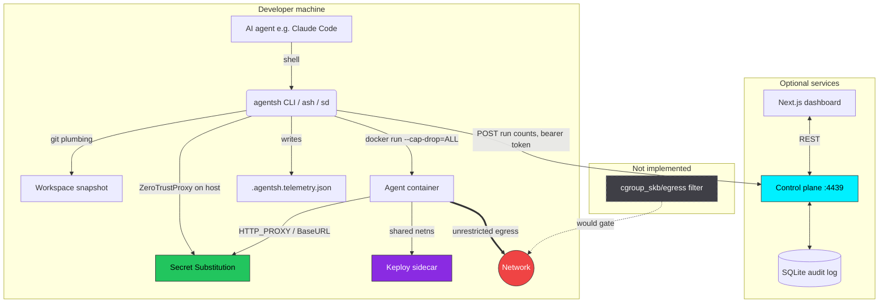

# 🏗️ agentsh Architecture

`agentsh` (formerly StuntDouble) wraps an AI coding agent in a restricted container, snapshots the workspace so its changes can be reverted, and reports run telemetry to an optional control plane.

## Components

### 1. CLI (`cli/`) — working
The core of the project. Available as `agentsh`, with short alias `ash` and backwards-compatible `sd`.

- `agentsh run <agent>` — pulls the runtime image, starts a Keploy sidecar, snapshots the workspace, boots the `ZeroTrustProxy`, and runs the agent with `--cap-drop=ALL`, `--memory=2g`, `--cpus=1.0` and the working directory mounted at `/workspace`. Calls `ebpf.AttachInterceptor` first and **refuses to run** unless `--allow-unenforced-network` acknowledges that kernel network filtering is open.
- `agentsh rewind` — restores the workspace from the snapshot (`git restore` + removal of untracked files).
- `agentsh checkpoint` — manages named zero-copy workspace snapshots.
- `agentsh guard prompt` — regex analyzer and sanitization for indirect prompt injections and system overrides.
- `agentsh dlp scan` — scans and redacts PII and sensitive credentials in inputs or files.
- `agentsh record <cmd>` — runs the command under Keploy to capture mocks. Privileged container.
- `agentsh stats` / `agentsh monitor` — local run counts; `monitor` polls the control plane.
- `agentsh serve` — serves local telemetry on loopback for the dashboard.
- `agentsh init`, `agentsh ci` — config and GitHub workflow scaffolding.

### 2. Zero-Trust API Proxy (`cli/pkg/proxy/`) — working
Dynamic proxy running on the host that intercepts agent requests directed to `host.docker.internal`. Injects real host API keys (`ANTHROPIC_API_KEY`, `OPENAI_API_KEY`) on outbound calls, while providing dummy credentials (`sd-dummy-anthropic-key-000`) inside the container so untrusted agents never hold real secrets.

### 3. Egress filter (`cli/pkg/ebpf/`) — **not implemented**
`AttachInterceptor` returns `ErrUnsupported` on all platforms. The BPF C program in `cli/pkg/ebpf/bpf_prog.c` is not compiled into the binary. Work required to complete it is documented in `MAINTENANCE.md`.

### 4. Control plane (`control-plane/`) — working, telemetry only
Go service on `127.0.0.1:4439`. Requires a bearer token (`STUNTDOUBLE_TOKEN`) on every endpoint except `/api/health`, and refuses to start without one. Single-origin CORS.
Aggregates run counts, stores an audit log in SQLite with HMAC-SHA256 signature chaining (`/api/audit/verify`), and serves policy documents over REST and GraphQL.

### 5. Dashboard (`dashboard/`, `docs/`) — working
Next.js client that polls the control plane with a bearer token. Real API metrics; displays `—` when unreachable.

### 6. Containerized Test Harness — working
`Dockerfile.test` and `scripts/test-in-container.sh` allow running the entire test suite in an isolated Docker container without modifying the host system.

### 7. Archived Experimental Prototypes (`experimental/`)
Unmaintained prototypes for reference:
`experimental/stuntos/`, `experimental/mac/`, `experimental/windows/`, `experimental/stuntbot/`, `experimental/simulate.sh`.

## Trust model
The agent container is the untrusted component:
- it holds dummy credentials substituted on egress
- it has unrestricted network access (until Linux eBPF filter is attached)
- it has read/write access to the mounted workspace

`agentsh` eliminates the risk of agent errors, refactoring mistakes, runaway memory loops, and rogue file deletions by providing a zero-overhead instant rollback mechanism.
