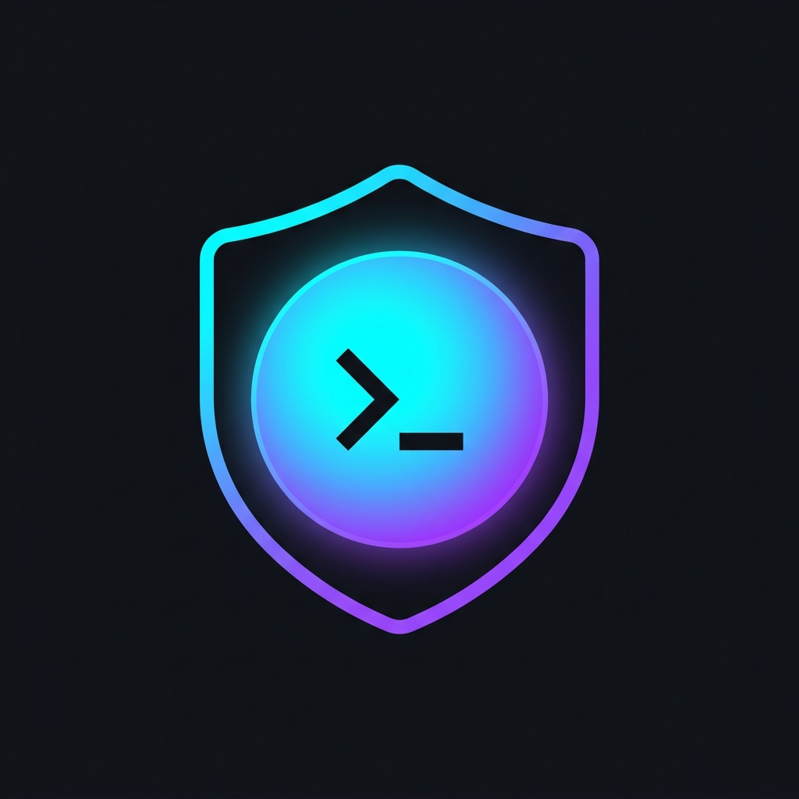

<div align="center">
  
  <h1>🛡️ agentsh</h1>
  <p><b>A restricted container shell & instant rollback environment for autonomous AI coding agents</b></p>

  [](https://www.npmjs.com/package/agentsh)
  [](https://opensource.org/licenses/MIT)
</div>

<br/>

`agentsh` (CLI: `agentsh`, `ash`, or legacy alias `sd`) runs autonomous coding agents (Claude Code, Cursor, OpenDevin, aider, bash/sh) inside a Docker container with dropped capabilities and resource limits, snapshots your workspace so you can undo what the agent did, and records what happened.

## ⚠️ What this does and does not protect against

Read this before relying on `agentsh` for anything.

**What works today:**

| Control | Mechanism |
| --- | --- |
| No new privileges in the sandbox | `--cap-drop=ALL` on the agent container |
| Bounded CPU, memory & time | `--memory=2g --cpus=1.0 --max-duration=15m` |
| Filesystem scope | only the working directory is bind-mounted at `/workspace` |
| Undo agent changes | workspace snapshot via git plumbing; `agentsh rewind` and `agentsh checkpoint` |
| Zero-Trust API Credentials | dummy key substitution proxy (`ZeroTrustProxy`) on host egress |
| Indirect Prompt Injection Guard | adversarial prompt vector detector & sanitizer via `agentsh guard prompt` |
| Enterprise AI Data Loss Prevention | PII & secret inspection scanner via `agentsh dlp scan` |
| Synthetic Offline Mocking | auto-generate synthetic DB & API mocks via `agentsh mock` |
| CI/CD Security Gate | `agentsh verify` security compliance gate |
| Run history | local JSON counter, control plane + dashboard |

**What does not work:**

- **Network egress filtering is not implemented on any platform.** `cli/pkg/ebpf.AttachInterceptor` returns `ErrUnsupported` on Linux, macOS and Windows alike. The BPF program in `cli/pkg/ebpf/bpf_prog.c` is marked `// +build ignore` and no build step compiles it. `agentsh run` requires `--allow-unenforced-network` to proceed, which is how you acknowledge this.
- **Policies are advisory everywhere.** `blocked_ports`, `strict_egress` and allow/deny lists are parsed, distributed and displayed — but no code path applies them to a connection.
- **The audit ledger is only tamper-evident against direct database edits.** `/api/audit/verify` checks an HMAC-SHA256 chain, but the signing key is `STUNTDOUBLE_TOKEN` — the same bearer token every CLI client must hold to write logs. Any authorized client can therefore forge a valid chain. It detects someone editing `stuntdouble_audit.db` behind the server's back; it does not detect a client that lies.
- **`agentsh record` runs Keploy privileged** with `--pid=host` and `--net=host`. That is a broad grant on your host.

See [docs/ENFORCEMENT.md](./docs/ENFORCEMENT.md) for the full boundary and the plan to close it.

## 🚀 Quick start

### 1. Install the CLI

```bash
curl -sSL https://raw.githubusercontent.com/itsrohan-lang/agentsh/main/install.sh | bash
```

Installs `agentsh` with aliases `ash`, `sd`, and `stuntdouble` to `/usr/local/bin` after verifying the SHA-256 release checksum.

Alternatively, install via npm:

```bash
npm install -g agentsh
```

### Uninstallation

```bash
curl -sSL https://raw.githubusercontent.com/itsrohan-lang/agentsh/main/uninstall.sh | bash
```

### 2. Sandbox an agent

```bash
agentsh run claude --allow-unenforced-network
# or using short alias:
ash run claude --allow-unenforced-network
```

This pulls the runtime image, starts a Keploy sidecar, snapshots the workspace, and runs the agent in a container with `--cap-drop=ALL` and the current directory mounted at `/workspace`. Pick a different base image with `-e python:3.11-alpine`.

`--allow-unenforced-network` is required to acknowledge that kernel network filtering is open.

### 3. Undo what it did

```bash
agentsh rewind
```

Restores tracked files to the pre-run snapshot and removes files created since. **This discards uncommitted work**, including your own changes made after the run started.

## 🧪 Containerized Testing

To run the entire test suite in an isolated Docker container without touching the host system:

```bash
./scripts/test-in-container.sh
```

## 🏢 Optional: control plane and dashboard

```bash
docker compose up -d
```

Open `http://localhost:3000` to view the dashboard connected to the control plane at `127.0.0.1:4439`.

## 📂 Repository layout

| Path | Status |
| --- | --- |
| `cli/` | Go CLI (`agentsh`, `ash`, `sd`) — core engine with ZeroTrustProxy, checkpointing & guardrails |
| `control-plane/` | Go telemetry + HMAC-SHA256 audit ledger service |
| `dashboard/`, `docs/` | Next.js SOC dashboard and documentation site |
| `cli/pkg/ebpf/` | Stub — returns `ErrUnsupported` pending Linux eBPF compilation |
| `experimental/` | Archived prototypes (StuntOS Firecracker script, macOS ESF, Windows WFP, stuntbot) |
| `charts/`, `k8s-operator/`, `terraform-provider-stuntdouble/` | Helm chart, CRD reconciler & Terraform provider |

## 📝 License

MIT.
